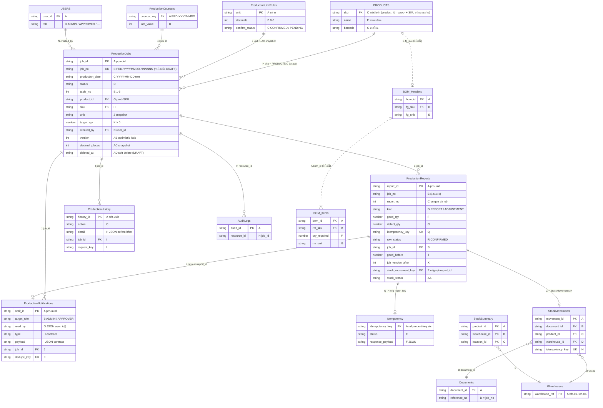

# Stockify — ข้อเสนอ Schema และแผน Migration: โมดูล "ระบบสั่งผลิตและรายงานผลผลิต"

> บทบาท: Database Specialist (Backend Dev เป็นเจ้าของโมดูล) · จัดทำ 8 ต.ค. 2026 ~16:00 น. (เวลาไทย)
> งานนี้ **ออกแบบ + ตรวจแบบอ่านอย่างเดียว**: ไม่ได้เขียน Google Sheet ใด ๆ และไม่ได้แก้ไฟล์บนเครื่องผู้ใช้
> ปลายทางใน repo ที่แนะนำ: `docs/production-schema-proposal.md`
> แหล่งข้อมูล: spec (`production-module-spec.md`), โค้ดปัจจุบัน (สำเนาตรง `/workspace/stockify/live-prod-v2/stockify-app/` = branch `refactor/structure` @ `15f92ff`), ชีตจริง "ไฟ" (อ่านด้วย `read_range` เท่านั้น ~15:58 น.), export `stockify.xlsx` (เช้านี้), `PRODUCTION_DB_ANALYSIS.md`, `audit.md`, `SHEET_HEADERS_THAI_PLAN.md`, การสแกน env/config บนเครื่อง DESKTOP-53N3M5H (ดูเฉพาะ **ชื่อตัวแปร** และ spreadsheet ID)
> `api-contract.md` ของ Backend Dev (v1.0, 16:19 น.) มาถึงหลังร่างแรก — ปรับให้สอดคล้องแล้ว (ชื่อ field `decimal_places`, แจ้งเตือน H `type` / I `payload`) จุดที่ขัดกันสรุปไว้ใน **§19** — Backend Dev ตัดสิน C1/C2/C9 แล้ว (16:23 น.) และแบ่งงานเป็น Phase 1/Phase 2 (**§20**)

---

## 0. สรุปสั้น (TL;DR)

1. **ไม่มี dev/staging DB ที่แอปเขียนได้** — ทุก env ชี้ชีตจริง; Supabase `stockify-staging` มีอยู่แต่ไม่ได้ต่อกับแอป (ไม่มี `DATABASE_URL`, repository Postgres เป็น scaffold) และไม่มีตารางผลิต ⇒ migration ต้องรันกับ **สำเนาชีต** ก่อน และ **การแตะชีตจริงต้องได้รับอนุมัติจากผู้ใช้** (สคริปต์บังคับเอง)
2. **คง 4 แท็บเดิมของ v2** (`ProductionJobs`, `ProductionReports`, `ProductionHistory`, `ProductionNotifications`) โดย **ต่อคอลัมน์ท้ายเท่านั้น** + เพิ่ม 2 แท็บเล็ก (`ProductionCounters`, `ProductionUnitRules`) — ไม่แตะ PRODUCTS/StockSummary/BOM
3. ข้อจำกัดที่ค้นพบซึ่งกำหนดการออกแบบ:
   - **แอปเขียนผ่าน Apps Script** (env ไม่มี service account) และ Apps Script/`script-signer.ts` จำกัด **≤ 30 คอลัมน์ต่อแถว** ⇒ `ProductionJobs` (27) เพิ่มได้อีก **3 คอลัมน์** เท่านั้น: `version`, `ทศนิยมที่อนุญาต`, `ลบร่างเมื่อ`
   - `doPost` ของ Apps Script ถือ **`LockService.getScriptLock()` ทั่วทั้งสคริปต์** ⇒ เป็นกลไกเดียวที่ serialize ข้ามทุก instance ของ Vercel ได้จริง ⇒ ให้ทุกคำสั่งที่เปลี่ยนข้อมูลผลิตรันเป็น **"คำสั่งเดียวใน Apps Script ภายใต้ lock"** (ออกเลข, ตรวจซ้ำ, CAS version, idempotency) — **นี่คือ PHASE 2** (ต้อง redeploy Apps Script ของชีตจริง ⇒ ต้องได้รับอนุมัติจากผู้ใช้ก่อน; ดู §20 และ `phase2/`)
4. **ตอบ Backend Dev**: (1) ไม่มี dev sheet/Apps Script/Supabase ที่ใช้ได้ (2) **ไม่มีคอลัมน์ทศนิยม/precision ในชีตเลย**; หน่วยมีที่ `BOM_Headers!E`, `BOM_Items!G`, แท็บโกดัง `E` (สูตร), `ProductionJobs!J` (snapshot) — **PRODUCTS ไม่มีหน่วย** (3) ใช้ **`version` จำนวนเต็ม** แทน `updated_at`, เก็บ **snapshot ทศนิยมบนงาน** (`AC`), รายงานมี `สถานะรายงาน=CONFIRMED` (ไม่มีลบ/แก้ ใช้รายการปรับปรุง)
5. คำถามที่ต้องให้ผู้ใช้ตอบ: วิธีตัดวัตถุดิบ (BOM), หน่วย/ทศนิยมที่ถูกต้องของสินค้า (งานเดิมบันทึก "ชิ้น" แต่ BOM/โกดังบอก "ชุด"), การแก้เลขใบซ้ำ, คลังรับสินค้าสำเร็จรูป (`wh-02` vs `wh-2` ในโค้ด) — ดู §17

---

## 1. ผลการตรวจหา dev/staging DB (คำถาม Backend Dev ข้อ 1)

| สิ่งที่ตรวจ | ผล |
|---|---|
| `C:\Stockify\stockify-app\.env.local` | `GOOGLE_SHEET_ID = 1tsndbJWnXPvY3_LQhtzVNPRMJxqjan3ScQXSvIUKPg4` (**ชีตจริง**) · `GOOGLE_SCRIPT_URL` ตั้งค่า · `GOOGLE_SERVICE_ACCOUNT_EMAIL` / `GOOGLE_PRIVATE_KEY` **ว่าง** · ไม่มี `DATABASE_URL` · ไม่มี `STORAGE_DRIVER` (ค่าเริ่มต้น = sheets) |
| `.env.vercel` | `GOOGLE_SHEET_ID` = ชีตจริง · ไม่มีตัวแปร service account ในไฟล์ |
| `.env.preview.local` (ดึงจาก Vercel Preview) | `GOOGLE_SHEET_ID = "[SENSITIVE]"` (Vercel ปิดค่า) ⇒ **ยืนยันไม่ได้ว่า Preview ชี้ชีตไหน** — ต้องถามผู้ใช้/ดูใน Vercel |
| `.env.example` | `STORAGE_DRIVER=sheets`, `GOOGLE_SHEET_ID=` ว่าง, `DATABASE_URL=` ว่าง ("Required only when STORAGE_DRIVER=postgres") |
| `C:\Stockify\sheet_sync\.env` | `STOCKIFY_SHEET_ID` = ชีตจริง |
| spreadsheet ID อื่นในโค้ด/เอกสาร/สคริปต์ | **ไม่พบ** (สแกน .ts/.js/.gs/.py/.json/.md/.yml ไม่รวม node_modules/.git/backup) · snapshot เก่าบน box มี ID ชีตจริง hard-code ใน `scripts/test-csv.ts` |
| Apps Script | สคริปต์ผูกกับไฟล์ชีตจริง (`SpreadsheetApp.getActiveSpreadsheet()`), ไม่มี `.clasp.json`/`appsscript.json`, ไม่มี URL dev แยก |
| Supabase | มีโปรเจกต์ **`stockify-staging`** (ref `imiqvhqjlsvfgzdwaolq`, ap-southeast-1) ตาม `docs/supabase-staging-setup.md`; migrations 4 ไฟล์ใน `supabase/migrations/` (15 ตาราง: products, stock_*, documents, bom_formulas…) — **ไม่มีตารางผลิต** · แอปเชื่อมไม่ได้: ไม่มี `DATABASE_URL` ในไฟล์ env ใด, `src/server/repositories/postgres/scaffold.repository.ts` มี throw/not-implemented 66 จุด |
| SQLite / Prisma / Drizzle / docker-compose | ไม่พบ |

**ข้อสรุป:** ไม่มี dev/staging Google Sheet + Apps Script และไม่มี Supabase dev DB ที่ใช้กับโมดูลนี้ได้ ⇒ แผน migration เป็น **สคริปต์ Apps Script ที่รันกับสำเนาชีต** (dry run เป็นค่าเริ่มต้น) และ **ห้ามแตะชีตจริงจนกว่าผู้ใช้อนุมัติ** · หลักฐานเพิ่ม: งาน 2 แถวเมื่อ 7 ต.ค. ถูกสร้างจาก dev server บนเครื่องลงชีตจริง ⇒ **การทดสอบบนเครื่องตอนนี้ = เขียนชีตจริง** (ดู README ขั้น [E] สำหรับการชี้แอป dev ไปยังสำเนา)

---

## 2. ข้อจำกัดของแพลตฟอร์มที่กำหนดการออกแบบ

| # | ข้อจำกัด | หลักฐาน | ผลต่อ schema |
|---|---|---|---|
| P1 | อ่าน/เขียน **ตามตำแหน่งคอลัมน์** (`A2:AA`, `updateRow(idx+2)`) | `production-job.service.ts:217,221,335,1073`; `client.ts` | ห้ามแทรก/สลับ/เปลี่ยนชื่อคอลัมน์และแท็บ; ต่อท้ายเท่านั้น; แถว 1 = หัวตาราง 1 แถว |
| P2 | Apps Script + `script-signer.ts` รับ **≤ 30 คอลัมน์/แถว** (`MAX_COLS_PER_ROW = 30`; signer `row.length > 30`) และ `doAppend` throw ถ้าเกิน `getMaxColumns()` | `.gs:53,418`; `script-signer.ts:243,259` | `ProductionJobs` 27 → **สูงสุด 30** (เพิ่มได้ 3); `ProductionReports` ออกแบบ 28; ถ้าจะเกิน 30 ต้องแก้ทั้ง 2 จุด + deploy Apps Script ใหม่ก่อน |
| P3 | env บนเครื่องและ `.env.vercel` **ไม่มี service account** ⇒ เขียนผ่าน Apps Script, อ่านผ่าน `GOOGLE_API_KEY` | สแกน env | `ensureSheetTabExists` (ต้องใช้ SA) ไม่ทำงาน → อธิบายว่าทำไม `ProductionReports`/`Notifications` ยังไม่มี; migration ต้องสร้างแท็บให้ |
| P4 | `doPost` ถือ `LockService.getScriptLock()` ทุกคำขอ (tryLock 30 วินาที) | `.gs:739-841` | lock ข้าม instance ที่ใช้ได้จริงตัวเดียว ⇒ คำสั่งผลิตต้องเป็น **action เดียว** ใน Apps Script (ดู §8) |
| P5 | heuristic ตัด "แถวหัวตาราง" ทางอ่านด้วย API key: ถ้า **แถวแรกที่คืนมา** (แม้ช่วง `A2:`) มีคำ `id`, `_id`, `sku`, `รหัส`, `ลำดับ`, `bom`, `header` ในคอลัมน์ A หรือ `sku`/`รหัส`/`barcode` ในคอลัมน์ B จะถูกตัดทิ้ง ⇒ index เลื่อน → `idx+2` เขียนผิดแถว | `client.ts:530-555` | ค่าในคอลัมน์ A/B ของทุกแท็บใหม่ต้องไม่มีคำเหล่านี้ (`prj-`, `prr-`, `prh-`, `prn-`, `PRD-…`, ชื่อหน่วยไทย ✓) · **ห้ามใช้ prefix `idem…`** (มี "id") · แนะนำแก้ client ให้ไม่ตัดเมื่อช่วงเริ่ม `A2` |
| P6 | Data validation **ไม่ถูกบังคับ** กับ Sheets API; กับ Apps Script `setValues` อาจ throw แบบไม่สม่ำเสมอ | Google Developers community / StackOverflow | ใช้ validation แบบ **เตือน** เป็นชั้นสำรองสำหรับคนแก้มือ; กฎจริงอยู่ฝั่งเซิร์ฟเวอร์ |
| P7 | อ่านด้วย API key ได้เพราะชีตเปิด anyone-with-link | audit C1 | ถ้าปิดลิงก์ตามคำแนะนำ audit ต้องตั้ง service account ก่อน (ไม่งั้นแอปอ่านไม่ได้) |
| P8 | `USER_ENTERED` แปลง `YYYY-MM-DD` เป็น date serial (ชีตจริง `ProductionJobs!C2 = 46302`) | `read_range` UNFORMATTED | migration ตั้ง format คอลัมน์ C เป็น Plain text และแปลงค่าเดิมเป็นข้อความ |

---

## 3. ภาพรวม schema

| แท็บ | สถานะ | คอลัมน์ | บทบาท |
|---|---|---|---|
| `ProductionJobs` | มีอยู่ (header แทรกแล้ว) → **ต่อท้าย AB–AD** | 30 | ใบสั่งผลิต 1 แถว = 1 สินค้า × 1 โต๊ะ |
| `ProductionReports` | **ยังไม่มีในชีต** → สร้าง (A–Q ตามโค้ด + R–AB) | 28 | บัญชีผลผลิตแบบ append-only: รายงานแต่ละรอบ + รายการปรับปรุง (ก่อน–หลัง) |
| `ProductionHistory` | มีอยู่ (header แทรกแล้ว) → **ต่อท้าย I–L** | 12 | audit trail ระดับธุรกิจ (ใคร/เมื่อ/อะไร/ก่อน–หลัง) |
| `ProductionNotifications` | **ยังไม่มี** → สร้าง (A–G ตามโค้ด + H–L) | 12 | แจ้งเตือนในระบบ + อ่านแล้ว/ยังไม่อ่าน |
| `ProductionCounters` | ใหม่ | 4 | ตัวนับเลขใบสั่งผลิตต่อวัน (กันเลขซ้ำ) |
| `ProductionUnitRules` | ใหม่ | 5 | หน่วย → จำนวนทศนิยมที่อนุญาต |
| `Idempotency`, `AuditLogs`, `OperationJournal`, `StockMovements`, `Documents`, `StockSummary`, `โกดัง2`, `PRODUCTS`, `USERS`, `Warehouses`, `LOCATIONS`, `BOM_*` | มีอยู่ — **ไม่เปลี่ยนโครงสร้าง** | — | ใช้ร่วม/อ้างอิง |

### 3.1 ER diagram

---

## 4. รายละเอียดแต่ละแท็บ

สัญลักษณ์: **[เดิม]** = คอลัมน์ที่มีอยู่แล้ว (ห้ามย้าย/เปลี่ยนชื่อ) · **[ใหม่]** = ต่อท้าย · Null = ว่างได้ไหม · ทุกเวลาเก็บเป็น ISO-8601 UTC (`…Z`) ตามมาตรฐานเดิม แสดงผลเป็นเวลาไทย

### 4.1 `ProductionJobs` (A–AD, 30 คอลัมน์ = เต็มเพดาน)
อ่าน `A2:AD` (โค้ดปัจจุบันอ่าน `A2:AA` — ต้องขยาย) · PK `job_id` · UK `job_no` (เมื่อไม่ว่าง)

| คอล | ชื่อหัวตาราง | field | ชนิด | Null | กฎ |
|---|---|---|---|---|---|
| A [เดิม] | job_id | job_id | string `prj-<uuid v4>` | ไม่ | PK, ไม่ซ้ำ, ไม่เปลี่ยนตลอดอายุ — **ใช้เป็น key อ้างอิงทุกแท็บ** |
| B [เดิม] | เลขใบสั่งผลิต | job_no | `PRD-YYYYMMDD-NNNNNN` | ได้ (DRAFT) | UK เมื่อไม่ว่าง; ออกโดย Apps Script ภายใต้ lock (§6); ไม่ใช้ซ้ำแม้ยกเลิก |
| C [เดิม] | วันที่ผลิต | production_date | text `YYYY-MM-DD` (format Plain text) | ไม่ | วันที่ตามปฏิทินไทย; กรอง/เรียงแบบสตริงได้ |
| D [เดิม] | สถานะ | status | enum DRAFT/WAITING/IN_PROGRESS/COMPLETED/CANCELLED | ไม่ | ตาม state machine §7 |
| E [เดิม] | โต๊ะ | table_no | int | ไม่ | 1–5 |
| F [เดิม] | ความสำคัญ | priority | enum NORMAL/URGENT/CRITICAL | ไม่ | ป้าย "งานด่วน" = URGENT/CRITICAL |
| G [เดิม] | product_id | product_id | `prod-<SKU>` | ไม่ | FK ตรรกะ → PRODUCTS (= "prod-" + PRODUCTS.C) |
| H [เดิม] | รหัสสินค้า | sku | string | ไม่ | ต้องตรง PRODUCTS.C **แบบตรงตัว (trim)** — เลิก fuzzy match |
| I [เดิม] | ชื่อสินค้า | product_name | string | ไม่ | snapshot จาก PRODUCTS.E |
| J [เดิม] | หน่วย | unit | string | ไม่ | snapshot ตอนสร้าง/แก้สินค้า; ต้องมีใน `ProductionUnitRules.A` |
| K [เดิม] | เป้าหมาย | target_qty | number | ไม่ | **> 0**, ทศนิยมไม่เกิน AC (= จำนวนสินค้าดี ไม่รวมของเสีย) |
| L [เดิม] | หมายเหตุ | note | string ≤ 500 | ได้ | |
| M [เดิม] | ตำแหน่งเก็บ | location | string ≤ 50 | ได้ | ควรตรวจกับ LOCATIONS (โกดังรับเข้า) — ปัจจุบันข้อความอิสระ |
| N [เดิม] | ผู้สร้าง | created_by | user_id | ไม่ | FK → USERS.A |
| O [เดิม] | ชื่อผู้สร้าง | created_by_name | string | ไม่ | snapshot |
| P [เดิม] | สร้างเมื่อ | created_at | ISO UTC | ไม่ | |
| Q [เดิม] | ส่งงานเมื่อ | submitted_at | ISO UTC | ได้ | ตั้งเมื่อ DRAFT→WAITING |
| R [เดิม] | ผู้เริ่มผลิต | started_by_name | string | ได้ | (user_id ของผู้เริ่มอยู่ใน History) |
| S [เดิม] | เริ่มเมื่อ | started_at | ISO UTC | ได้ | |
| T [เดิม] | จบเมื่อ | completed_at | ISO UTC | ได้ | ล้างเมื่อ reopen |
| U [เดิม] | ยกเลิกเมื่อ | cancelled_at | ISO UTC | ได้ | |
| V [เดิม] | ชื่อผู้ยกเลิก | cancelled_by_name | string | ได้ | |
| W [เดิม] | เหตุผลยกเลิก | cancel_reason | string ≤ 500 | ได้ | บังคับเมื่อยกเลิก |
| X [เดิม] | เหตุผลจบงาน | close_reason | string ≤ 500 | ได้ | บังคับเมื่อจบไม่ครบ/เกินเป้า |
| Y [เดิม] | เหตุผลเปิดใหม่ | reopen_reason | string ≤ 500 | ได้ | บังคับเมื่อ reopen (ค่าล่าสุด; ประวัติเต็มอยู่ใน History) |
| Z [เดิม] | จำนวนครั้งเปิดใหม่ | reopen_count | int | ไม่ | ≥ 0 |
| AA [เดิม] | อัปเดตเมื่อ | updated_at | ISO UTC | ไม่ | **การตรวจรอง** ของ optimistic lock (ต้องตรงพร้อม AB; C2) — bump ทุกคำสั่ง |
| **AB [ใหม่]** | version | version | int | ไม่ (ว่าง = 1 สำหรับแถวเก่า) | เริ่ม 1, **+1 ทุกครั้งที่คำสั่งใดแตะงานนี้** (แก้ไข/ส่ง/เริ่ม/รายงาน/ปรับปรุง/ยกเลิก/เปิดใหม่) — ใช้ compare-and-swap |
| **AC [ใหม่]** | ทศนิยมที่อนุญาต | decimal_places | int 0–3 | ไม่ (ว่าง = 0) | snapshot จาก `ProductionUnitRules` ตอนสร้าง/เปลี่ยนสินค้า; ใช้ตรวจ K และยอดในรายงาน |
| **AD [ใหม่]** | ลบร่างเมื่อ | deleted_at | ISO UTC | ได้ | soft delete สำหรับ DRAFT แทนการลบแถว (ลบแถวในชีตแบบ positional อันตราย — บั๊ก `deleteDraft` ลบผิดแถว) · แถวที่มีค่า = ซ่อนจากทุกหน้า/ทุกยอด |

ค่าคำนวณ (ไม่เก็บ): `produced_good = Σ ProductionReports.F` (ทุกแถว CONFIRMED ของ job_id — REPORT บวก, ADJUSTMENT เป็น delta ±), `defect_total = Σ G`, `remaining = max(0, K − produced_good)`, `over = max(0, produced_good − K)`, ป้าย "จบต่ำกว่าเป้า" = COMPLETED ∧ remaining > 0, "ผลิตเกิน" = over > 0, "มีของเสีย" = defect_total > 0

> เพดาน 30 คอลัมน์เต็มแล้ว — คอลัมน์ต่อไปของแท็บนี้ต้องยก `MAX_COLS_PER_ROW` ทั้งใน `scripts/google-apps-script.gs` และ `src/server/google-sheets/script-signer.ts` แล้ว deploy Apps Script ก่อน

### 4.2 `ProductionReports` (A–AB, 28 คอลัมน์) — append-only, รวมรายการปรับปรุง
PK `report_id` · UK `idempotency_key` · UK (`job_id`, `report_no`) · ห้ามแก้/ลบแถว ยกเว้น `AA` (สถานะลงสต๊อก) โดย reconciler

| คอล | หัวตาราง | field | ชนิด | Null | กฎ |
|---|---|---|---|---|---|
| A [เดิมในโค้ด] | report_id | report_id | `prr-<uuid>` | ไม่ | PK |
| B | เลขใบสั่งผลิต | job_no | string | ไม่ | ค่าแสดงผล ณ เวลาบันทึก (join ใช้ S) |
| C | รอบที่ | report_no | int ≥ 1 | ไม่ | = จำนวนแถวของ job_id นี้ + 1 (คำนวณใน lock) |
| D | ชนิด | kind | REPORT / ADJUSTMENT | ไม่ | |
| E | ประเภทรายงาน | report_kind | PARTIAL / FINAL / "" | ได้ | บังคับเมื่อ REPORT; ว่างเมื่อ ADJUSTMENT |
| F | ผลิตดี | good_qty | number | ไม่ | REPORT: ≥ 0 (ยอด **รอบนี้**) · ADJUSTMENT: delta ± · ทศนิยม ≤ job.AC |
| G | ของเสีย | defect_qty | number | ไม่ | เหมือน F · REPORT: F+G > 0 |
| H | สาเหตุของเสีย | defect_cause | string ≤ 500 | ได้ | **บังคับเมื่อ G > 0** |
| I | เหตุผล | reason | string ≤ 500 | ได้ | บังคับเมื่อ (FINAL ∧ ขาดเป้า) ∨ (ยอดดีสะสมหลังรอบนี้ > เป้า — ทั้ง PARTIAL/FINAL ตาม spec ข้อ 4) ∨ ADJUSTMENT |
| J | หมายเหตุ | note | string ≤ 500 | ได้ | |
| K | ลิงก์รูปภาพ | photo_url | URL ≤ 1000 | ได้ | (ที่เก็บไฟล์รูป = คำถามเปิดสำหรับ Backend Dev) |
| L | ผู้รายงาน | reported_by | user_id | ไม่ | FK → USERS.A |
| M | ชื่อผู้รายงาน | reported_by_name | string | ไม่ | |
| N | รายงานเมื่อ | reported_at | ISO UTC | ไม่ | |
| O | ดีสะสม | cumulative_good | number ≥ 0 | ไม่ | ยอดดีสะสม **หลัง** แถวนี้ |
| P | เสียสะสม | cumulative_defect | number ≥ 0 | ไม่ | ยอดเสียสะสมหลังแถวนี้ |
| Q | idempotency_key | idempotency_key | string 8–100 | ไม่ | UK (จาก client) |
| **R [ใหม่]** | สถานะรายงาน | row_status | CONFIRMED | ไม่ | แอปเขียน CONFIRMED เท่านั้น (รายงานถูกยืนยันใน UI ก่อนส่ง ไม่มีร่างเก็บในชีต); ไม่มี VOID — แก้ด้วย ADJUSTMENT |
| **S [ใหม่]** | job_id | job_id | `prj-…` | ไม่ | **FK หลัก** → ProductionJobs.A (ทนต่อการเปลี่ยนเลขใบ/เลขซ้ำ) |
| **T [ใหม่]** | ดีสะสมก่อน | good_before | number ≥ 0 | ไม่ | ยอดก่อนแถวนี้ (ADJUSTMENT: ยอด "ก่อน" ของ spec; "หลัง" = O) |
| **U [ใหม่]** | เสียสะสมก่อน | defect_before | number ≥ 0 | ไม่ | |
| **V [ใหม่]** | สถานะงานก่อน | job_status_before | enum | ไม่ | |
| **W [ใหม่]** | สถานะงานหลัง | job_status_after | enum | ไม่ | PARTIAL → IN_PROGRESS, FINAL → COMPLETED |
| **X [ใหม่]** | version งานหลังบันทึก | job_version_after | int | ไม่ | = ProductionJobs.AB หลังคำสั่งนี้ — ใช้ตรวจว่าคำสั่ง "ครบทุกขั้น" ตอน replay |
| **Y [ใหม่]** | โกดังรับเข้า | stock_warehouse_id | `wh-0N` | ได้ | ว่างถ้าไม่ลงสต๊อก (good ≤ 0 หรือยังไม่กำหนดคลัง) |
| **Z [ใหม่]** | คีย์ movement สต๊อก | stock_movement_key | `mfg-rpt-<report_id>` / `mfg-adj-<report_id>` | ได้ | = `StockMovements.H` (กันลงสต๊อกซ้ำ) |
| **AA [ใหม่]** | สถานะลงสต๊อก | stock_status | NONE / PENDING / POSTED / FAILED | ไม่ | NONE = ไม่ต้องลง (ของเสียล้วน/ไม่เปิดใช้การเชื่อมสต๊อก) |
| **AB [ใหม่]** | หน่วย | unit | string | ไม่ | snapshot หน่วยของงาน — กันรวมยอดต่างหน่วย |

### 4.3 `ProductionHistory` (A–L, 12 คอลัมน์) — append-only audit trail
| คอล | หัวตาราง | field | ชนิด | Null | กฎ |
|---|---|---|---|---|---|
| A [เดิม] | history_id | history_id | `prh-<uuid>` | ไม่ | PK |
| B [เดิม] | เลขใบสั่งผลิต | job_no | string | ได้ | ค่า ณ เวลานั้น |
| C [เดิม] | การกระทำ | action | CREATE/EDIT/DELETE/SUBMIT/START/REPORT_PARTIAL/REPORT_FINAL/ADJUST/CANCEL/REOPEN/RENUMBER | ไม่ | |
| D [เดิม] | ผู้ดำเนินการ | actor_id | user_id | ไม่ | FK → USERS.A |
| E [เดิม] | ชื่อผู้ดำเนินการ | actor_name | string | ไม่ | |
| F [เดิม] | เมื่อ | at | ISO UTC | ไม่ | |
| G [เดิม] | เหตุผล | reason | string | ได้ | บังคับสำหรับ EDIT หลังส่ง, CANCEL, REOPEN, ADJUST |
| H [เดิม] | รายละเอียด (JSON) | detail | JSON `{before:{…}, after:{…}, report_id?, source_job_no?, source_job_id?, replaced_by?, replaced_by_job_id?}` | ได้ | เก็บเฉพาะฟิลด์ที่เปลี่ยน ≤ 50,000 ตัวอักษร · **ลิงก์งานต้นทาง/งานแทน (transfer-remaining) เก็บที่นี่เท่านั้น** (C1): `CREATE` ของงานใหม่มี `source_job_no` + `source_job_id`, `CANCEL` ของงานเดิมมี `replaced_by` + `replaced_by_job_id` — ไม่มีคอลัมน์แยก |
| **I [ใหม่]** | job_id | job_id | `prj-…` | ไม่ (แถวเก่า backfill) | FK |
| **J [ใหม่]** | version ก่อน | version_before | int | ได้ | |
| **K [ใหม่]** | version หลัง | version_after | int | ได้ | |
| **L [ใหม่]** | คีย์คำขอ | request_key | string | ได้ | idempotency key ของคำสั่ง → กันประวัติซ้ำตอน replay |

### 4.4 `ProductionNotifications` (A–L, 12 คอลัมน์)
| คอล | หัวตาราง | field | ชนิด | Null | กฎ |
|---|---|---|---|---|---|
| A [เดิมในโค้ด] | notif_id | notif_id | `prn-<uuid>` | ไม่ | PK |
| B | ถึงบทบาท | target_role | ADMIN / APPROVER | ไม่ | |
| C | เลขใบสั่งผลิต | job_no | string | ได้ | |
| D | ข้อความ | message | string | ไม่ | รายงานผลต้องมี: เลขใบ, โต๊ะ, สินค้า, ดีรอบนี้, เสียรอบนี้, ยอดสะสม, เป้าหมาย, หน่วย, สถานะ |
| E | สร้างเมื่อ | created_at | ISO UTC | ไม่ | |
| F | ผู้แจ้ง | created_by_name | string | ไม่ | |
| G | อ่านแล้วโดย (JSON) | read_by | JSON array ของ user_id | ไม่ (`[]`) | ยังไม่อ่านสำหรับผู้ใช้ u ⇔ u.role = B (หรือ u.id = L) ∧ u.id ∉ G (= `is_read` ของ contract) |
| **H [ใหม่]** | ประเภท | type | JOB_SUBMITTED / JOB_EDITED / JOB_STARTED / REPORT_PARTIAL / REPORT_FINAL / PRODUCTION_ADJUSTED / JOB_CANCELLED / JOB_REOPENED / LEGACY (ตาม api-contract §3.4) | ไม่ | แถวเก่า backfill = `LEGACY` |
| **I [ใหม่]** | ข้อมูลประกอบ (JSON) | payload | JSON: `{report_id, table_no, product:{product_id,sku,product_name,unit}, round_good, round_defect, cumulative_good, cumulative_defect, target_qty, status}` (ตาม api-contract §3.4) | ได้ | แถวเก่าว่าง → API คืนค่า `null`; `report_id` อยู่ใน payload |
| **J [ใหม่]** | job_id | job_id | `prj-…` | ได้ (แถวเก่าที่ job_no กำกวม) | FK ที่เชื่อถือได้ (job_no ซ้ำได้จริง); ลิงก์ API ยังใช้ `/production/jobs/{job_no}` ได้ |
| **K [ใหม่]** | คีย์กันแจ้งซ้ำ | dedupe_key | `<event>:<report_id>` หรือ `<event>:<job_id>:v<version_after>` | ไม่ | UK — ตรวจใน lock ก่อน append |
| **L [ใหม่]** | ถึงผู้ใช้ | target_user_id | user_id | ได้ | ว่าง = ทุกคนในบทบาท B (เผื่ออนาคต) |

### 4.5 `ProductionCounters` (ใหม่)
| คอล | หัวตาราง | ชนิด | กฎ |
|---|---|---|---|
| A | counter_key | `PRD-YYYYMMDD` | PK |
| B | เลขล่าสุด | int ≥ 0 | เพิ่มทีละ 1 ภายใต้ lock เท่านั้น |
| C | อัปเดตเมื่อ | ISO UTC | |
| D | อัปเดตโดย | string | job_id/คำสั่งที่ใช้เลข |
migration seed: `PRD-20261007 = 1` (หรือ 2 ถ้าเปิด renumber)

### 4.6 `ProductionUnitRules` (ใหม่)
| คอล | หัวตาราง | ชนิด | กฎ |
|---|---|---|---|
| A | หน่วย | string | PK (ตรงตัว, trim) |
| B | ทศนิยมที่อนุญาต | int 0–3 | 0 = จำนวนเต็มเท่านั้น |
| C | สถานะยืนยัน | CONFIRMED / PENDING | PENDING = ค่าเริ่มต้นจาก migration รอผู้ใช้ยืนยัน |
| D | หมายเหตุ | string | |
| E | อัปเดตเมื่อ | ISO UTC | |
migration seed 11 หน่วยที่พบในชีต: ชุด, ชิ้น, ใบ, อัน, ดวง, เส้น, ตัว, หัว, pcs., ลูก, คู่ — ทั้งหมด `ทศนิยม = 0, PENDING` (เหตุผล: เป็นหน่วยนับทั้งหมด และ **ไม่มีจำนวนทศนิยมเลยสักค่า** ใน StockSummary 1,212 แถว, StockMovements 1,812, BOM_Items 1,203, โกดัง2 1,235) · หน่วยที่ไม่มีในแท็บ ⇒ ถือว่า 0

---

## 5. การเชื่อมกับแท็บเดิม (สินค้า หน่วย สต๊อก)

| ความสัมพันธ์ | key | กติกา |
|---|---|---|
| งาน → สินค้า | `H sku` = `PRODUCTS!C` (trim, ตรงตัว); `G product_id` = `"prod-" + sku` | resolve ครั้งเดียวตอนสร้าง/เปลี่ยนสินค้า แล้ว snapshot G/H/I/J · **เลิก fuzzy** (`findById` ตัด `-_# ` + เทียบ barcode ทำให้ `AS-017`≡`AS017` ผูกผิดตัวได้) · PRODUCTS มี SKU ซ้ำ 1 ตัว (ลง-01), ว่าง 2 แถว, ลงท้าย "." 33 ตัว → ถ้าเจอซ้ำให้ปฏิเสธพร้อมข้อความ |
| งาน → หน่วย | `J unit` → `ProductionUnitRules!A` → snapshot `AC` | ที่มาของหน่วยต่อสินค้า = **คำถามเปิด** (PRODUCTS ไม่มีหน่วย; โค้ดปัจจุบันใส่ "ชิ้น" ตายตัว) |
| งาน → ผู้ใช้/สิทธิ์ | `N created_by`, Reports `L`, History `D` → `USERS!A`; บทบาท `USERS!D` (ADMIN 5, APPROVER 1, WAREHOUSE_STAFF 5, PACKER 2) | ตรวจสิทธิ์ฝั่งเซิร์ฟเวอร์ทุกคำสั่ง (`PRODUCTION_VIEW/MANAGE/REPORT` ใน `src/server/security/permissions.ts`) และ Apps Script ตรวจซ้ำจาก actor ใน envelope ที่เซ็น HMAC |
| รายงาน → สต๊อก | Reports `Z` = `StockMovements!H` (`mfg-rpt-<report_id>` / `mfg-adj-<report_id>`) · `Documents!D` = job_no · `StockMovements!B` = `Documents!A` | ลงเฉพาะ **ผลิตดีของแต่ละรายงานที่ยืนยัน ครั้งเดียว** (key ไม่ซ้ำ); FINAL ไม่ลงยอดสะสมซ้ำ; ของเสียไม่ลง; ADJUSTMENT ลง `ADJUST` = delta ผลิตดี · ต้องแก้บั๊กเดิม: `documents.create` สุ่ม document_id ใหม่ทำให้ movement ไม่เชื่อมเอกสาร (H1 ใน PRODUCTION_DB_ANALYSIS) |
| คลังรับเข้า | `Warehouses!A` = `wh-02` (โกดัง2) | โค้ด v2 ฮาร์ดโค้ด `wh-2` ซึ่ง **ไม่มีใน Warehouses** และจะแตกแถวใน StockSummary → ใช้ `wh-02` จาก config (ต้องให้ผู้ใช้ยืนยันคลัง) |
| product_id ใน StockSummary | `prod-<SKU>` (1,091 แถว) vs SKU ดิบ (121 แถว), แยกคู่ 41 คู่ | ก่อนลงสต๊อกให้ใช้รูปแบบ `prod-<SKU>` ตามข้อมูลส่วนใหญ่; ห้าม migration นี้รวมคู่ที่แยก (เป็นงานแยกที่ต้องอนุมัติ) |
| วัตถุดิบ (BOM) | — | **ไม่ตัด** จนกว่าผู้ใช้กำหนดวิธี (§16) |

---

## 6. Key, ความไม่ซ้ำ และการออกเลข (ปลอดภัยเมื่อคำขอพร้อมกัน)

| ค่า | วิธีสร้าง | ทำไมไม่ชน |
|---|---|---|
| `job_id`, `report_id`, `history_id`, `notif_id` | `prj-/prr-/prh-/prn-` + `crypto.randomUUID()` (ฝั่งแอป) | UUID v4 (โอกาสชน ~0) · ตรวจซ้ำด้วย TextFinder ใน lock อีกชั้น |
| `job_no` | **ใน Apps Script ภายใต้ script lock** ตอน "ยืนยันส่งงาน" (spec ข้อ 1: สร้างเลขเมื่อยืนยัน) : `n = max(Counters[PRD-<date>].B, max seq ที่พบใน ProductionJobs!B ของ prefix นี้) + 1` → ตรวจ `ProductionJobs!B` ด้วย `createTextFinder(no).matchEntireCell(true)` ว่าไม่มี → เขียน B ของงาน + Counters.B ในการเรียกเดียวกัน | lock ของ `doPost` serialize ทุกคำขอจากทุก instance; อ่าน-คำนวณ-เขียนอยู่ใน critical section เดียว (ต่างจากปัจจุบันที่อ่านผ่าน API แล้ว append คนละจังหวะ → เลขซ้ำ) |
| ส่งหลายงานพร้อมกัน | 1 คำสั่ง `submit` ที่มีหลาย job → ออกเลขเรียงกันในการเรียกเดียว | ทั้งชุดอยู่ใน lock เดียว |
| `report_no` | ใน lock: นับแถว Reports ที่ `S = job_id` + 1 | เช่นเดียวกัน |
| `dedupe_key` แจ้งเตือน | กำหนดจากเหตุการณ์ (ไม่สุ่ม) | ตรวจก่อน append ใน lock |
| วันที่ใน job_no | `production_date` (ตามโค้ดปัจจุบัน) | คำถามเปิดย่อย: ใช้วันที่ผลิตหรือวันที่ส่ง |

ข้อเสนอสำหรับ DRAFT: `job_no` ว่างจนกว่าจะส่ง; UI แสดง "ร่าง" และ route/API อ้าง `job_id` (ปัจจุบัน route ใช้ `[job_no]`) — ถ้า Backend Dev ยังให้ออกเลขตอนสร้าง ก็ใช้กลไก counter เดียวกันได้ แต่จะมีเลขที่ถูก "ลบร่าง" หายไปจากลำดับ

**เส้นทางเขียนต้องเป็น Apps Script เท่านั้นสำหรับคำสั่งผลิต** — ถ้า env ใดมี service account (เขียน Sheets API ตรง) จะไม่มี lock ข้าม instance ⇒ ให้ fail closed (ปฏิเสธคำสั่งผลิตถ้าไม่มี `GOOGLE_SCRIPT_URL`)

---

## 7. State machine

```mermaid
stateDiagram-v2
    [*] --> DRAFT: สร้าง (ADMIN)
    DRAFT --> DRAFT: แก้ไข/ย้ายโต๊ะ (ADMIN)
    DRAFT --> [*]: ลบร่าง = ตั้ง AD deleted_at (ADMIN)
    DRAFT --> WAITING: ยืนยันส่งงาน → ออกเลข + แจ้ง APPROVER
    WAITING --> WAITING: แก้สินค้า/จำนวน/โต๊ะ (ADMIN) + แจ้ง APPROVER
    WAITING --> IN_PROGRESS: เริ่มผลิต (APPROVER) + แจ้ง ADMIN
    WAITING --> CANCELLED: ยกเลิก + เหตุผล (ADMIN) + แจ้ง APPROVER
    IN_PROGRESS --> IN_PROGRESS: รายงานบางส่วน (APPROVER) + แจ้ง ADMIN / แก้เป้า-หมายเหตุ + เหตุผล (ADMIN) + แจ้ง APPROVER / ปรับปรุงยอด (ADMIN)
    IN_PROGRESS --> COMPLETED: รายงาน "จบงาน" (APPROVER) + แจ้ง ADMIN
    IN_PROGRESS --> CANCELLED: ยกเลิกส่วนที่เหลือ + เหตุผล (ADMIN) — ผลผลิตเดิมคงอยู่
    COMPLETED --> IN_PROGRESS: เปิดกลับมาผลิตต่อ + เหตุผล (ADMIN) + แจ้ง APPROVER
    COMPLETED --> COMPLETED: ปรับปรุงยอด (ADMIN)
    CANCELLED --> CANCELLED: ปรับปรุงยอด (ADMIN, เฉพาะงานที่มีผลผลิต)
```

| จาก → ถึง | บทบาท | เงื่อนไข/ฟิลด์ที่เขียน | แจ้งเตือน |
|---|---|---|---|
| DRAFT → (แก้) | ADMIN | แก้ได้ทุกฟิลด์แผน; version+1 | — |
| DRAFT → ลบ | ADMIN | `AD = now`; **ห้ามลบแถวจริง** | — |
| DRAFT → WAITING | ADMIN | ออก `B`, `Q submitted_at` | APPROVER `JOB_SUBMITTED` |
| WAITING → WAITING | ADMIN | แก้ G/H/I/J/AC/K/E (+L/F/M); เหตุผลใน History | APPROVER `JOB_EDITED` |
| WAITING → IN_PROGRESS | APPROVER (ADMIN ด้วยหากอนุญาต) | `R`, `S` | ADMIN `JOB_STARTED` |
| IN_PROGRESS → IN_PROGRESS (แก้) | ADMIN | แก้ได้เฉพาะ K, L + เหตุผลบังคับ | APPROVER `JOB_EDITED` |
| IN_PROGRESS → IN_PROGRESS (รายงาน PARTIAL) | APPROVER | แถว Reports; version+1 | ADMIN `REPORT_PARTIAL` |
| IN_PROGRESS → COMPLETED | APPROVER | `T completed_at`, `X close_reason` (บังคับถ้าไม่ครบ/เกิน) | ADMIN `REPORT_FINAL` |
| WAITING/IN_PROGRESS → CANCELLED | ADMIN | `U,V,W`; รายงานเดิมไม่ลบ; สต๊อกที่รับแล้วไม่กลับรายการอัตโนมัติ | APPROVER `JOB_CANCELLED` |
| COMPLETED → IN_PROGRESS | ADMIN | `Y`, `Z+1`, ล้าง `T` | APPROVER `JOB_REOPENED` |
| ปรับปรุงยอด | ADMIN | IN_PROGRESS/COMPLETED/CANCELLED; แถว ADJUSTMENT (ก่อน T/U → หลัง O/P); ยอดหลังต้อง ≥ 0 | (spec ไม่ระบุ — แนะนำแจ้ง APPROVER) |
| เปลี่ยนสินค้า/ย้ายโต๊ะหลังเริ่ม | ADMIN | ไม่อนุญาต: ยกเลิกส่วนที่เหลือ + สร้างงานใหม่ (History เก็บ `detail.replaced_by`) | ตามคำสั่งย่อย |
| COMPLETED/CANCELLED → รายงานเพิ่ม | — | **ปฏิเสธ** จนกว่าจะเปิดใหม่ | — |

ต่างจากโค้ดปัจจุบัน: ตัด `IN_PROGRESS → IN_PROGRESS` ที่เป็น "เปลี่ยนสถานะเปล่า" ออกจากตาราง transition (ให้เป็นการกระทำเฉพาะ), เพิ่ม soft delete, บังคับเหตุผลเมื่อเกินเป้าแม้เป็น PARTIAL

---

## 8. Versioning, Idempotency และ "transaction" บน Google Sheets

### 8.1 Optimistic locking (คำถาม Backend Dev ข้อ 3)
- **ใช้ `version` จำนวนเต็ม (AB)** แทน `updated_at`: เทียบแบบตัวเลขไม่กำกวม, ไม่พึ่งนาฬิกาของแต่ละ instance, ไม่เจอปัญหา Sheets แปลงรูปแบบข้อความ/เวลาชนกันระดับมิลลิวินาที
- client ส่ง `expected_version` กับ **ทุกคำสั่งที่เปลี่ยนงาน** (แก้ไข, ส่ง [ต่องาน], เริ่ม, รายงาน, ปรับปรุง, ยกเลิก, เปิดใหม่) → ใน lock: `if (row.AB || 1) !== expected → 409 VERSION_CONFLICT` พร้อมข้อมูลล่าสุด → UI แสดงสรุปยอดใหม่ให้ยืนยันอีกครั้ง (ตรงกับ spec "แสดงสรุปยอดรอบนี้และยอดสะสมก่อนยืนยัน")
- **ตัดสินแล้ว (C2):** `version` (AB) เป็น lock token หลัก; `updated_at` (AA) เป็น **การตรวจรอง** ในจุดเดียวกัน — ต้องตรงทั้งคู่ ทุกคำสั่งที่เปลี่ยนงาน bump ทั้ง AB (+1) และ AA (เวลาปัจจุบัน) รวมถึง adjust
- **Phase 1** (ไม่ redeploy Apps Script): ตรวจใน Next.js ภายใต้ `withKeyedLock` แล้วเขียนแถวงานทั้งแถว `A:AD` (AB = เดิม+1) — ยังเป็น compare-then-write ข้าม instance ของ Vercel ไม่ได้ (ข้อจำกัด H4 เดิม) แต่ปิดช่อง "ข้อมูลเก่าเขียนทับ" ภายใน instance และทำให้ข้อมูล version พร้อมสำหรับ Phase 2
- **Phase 2** (หลังผู้ใช้อนุมัติ redeploy): CAS จริงภายใน script lock ของ Apps Script ผ่าน `productionCommand` op `requireRow {expectVersion, expectUpdatedAt}` — ไม่ตรง ⇒ `PRD_VERSION_CONFLICT` + `current` (map เป็น 409 `VERSION_CONFLICT` ของ contract) โดยไม่เขียนอะไรเลย
- การเขียนแถวงาน: อ่านแถวด้วย TextFinder บนคอลัมน์ A (job_id) ใน lock → ตรวจ A อีกครั้ง → `setValues` เฉพาะแถวนั้น `A:AD` — ไม่ใช้ index จากการอ่านรอบก่อน (กันปัญหา heuristic ตัดแถว/แถวเลื่อน)

### 8.2 Idempotency
- client สร้าง key ต่อ "การกดยืนยัน 1 ครั้ง" (ไม่ใช่ต่อการเปิด modal — แต่ต้อง **คงค่าเดิมเมื่อรีเฟรช/ส่งซ้ำ**: เก็บใน sessionStorage จนกว่าได้คำตอบสำเร็จ)
- เก็บใน `Idempotency` เดิม (9 คอลัมน์): Phase 1: key รูปแบบเดิมของโค้ด `mfg-report-<client key>` / `mfg-adjust-<client key>` (ดู §19 C8) · Phase 2: `productionCommand` เขียนแถวของตัวเองเป็น `prdcmd:<command>:<client key>` (prefix แยก ไม่ชนแถวที่ Next.js เขียน) — ไม่ขึ้นต้นด้วย "id"; `payload_hash` = sha256 ของ payload → key เดิมแต่ payload ต่าง = 409 `IDEMPOTENCY_CONFLICT` (ตรรกะเดียวกับ `doAtomicStockOperation`)
- ชั้นที่ 2: `ProductionReports.Q` ไม่ซ้ำ; `ProductionHistory.L`, `ProductionNotifications.K`, `StockMovements.H` เป็นกุญแจกันซ้ำของแต่ละขั้น
- Idempotency เดิมมี key ซ้ำ 13 คู่ และค้าง PROCESSING 175 แถว → ต้องตรวจ/อัปเดตใน lock เท่านั้น · ใน `productionCommand` (Phase 2): COMPLETED → คืนผลเดิม (`replayed: true`), PROCESSING → `PRD_IDEMPOTENCY_IN_PROGRESS`, FAILED → `PRD_IDEMPOTENCY_FAILED` (กู้คืนด้วยมือ — ความหมายเดียวกับ `doAtomicStockOperation`), payload ต่าง → `PRD_IDEMPOTENCY_KEY_REUSED`

### 8.3 "Transaction" บน Sheets (ไม่มี rollback) — PHASE 2: `productionCommand`
ออกแบบตาม `phase2/production-command.gs` (ทดสอบออฟไลน์แล้ว) — **ตรรกะธุรกิจอยู่ใน Next.js เหมือนเดิม** (สิทธิ์, สถานะ, จำนวน, ทศนิยม, เหตุผล, ข้อความแจ้งเตือน) ส่วน Apps Script ทำเฉพาะสิ่งที่ต้อง atomic ข้าม instance ภายใต้ script lock ของ `doPost`:

| op | ทำอะไร |
|---|---|
| `requireRow` | หาแถวด้วย col A (ต้องเจอ 1 แถวพอดี) แล้วตรวจ `expectVersion` (บังคับสำหรับ ProductionJobs; AB ว่าง = 1), `expectUpdatedAt`, `expectStatusIn`, `requireNotDeleted` |
| `updateRow` | เขียนเฉพาะคอลัมน์ที่ส่งมา (2–30) ของแถวที่หาด้วย key; ProductionJobs ต้องมี `requireRow` ก่อนและต้อง `bumpVersion` (server เขียน AB = เดิม+1 เอง; client ห้ามเขียน A/AB) |
| `appendUnique` | append ถ้า key ในคอลัมน์ที่อนุญาตยังไม่มี (Reports A/Q, History A/L, Notifications A/K, Jobs A) — ซ้ำ = ข้าม (`skipped`) |
| `addToJsonArray` | เพิ่ม user_id ลง `ProductionNotifications!G` แบบอ่าน-รวม-เขียนใน lock (แทน `markNotificationsRead` ที่เขียนทับทั้งแถว) |
| `nextJobNo` | ออกเลข `PRD-YYYYMMDD-NNNNNN` จาก `ProductionCounters` และข้ามเลขที่มีอยู่แล้วใน ProductionJobs!B (ชีตจริงมีเลขซ้ำแล้ว); ใช้ผ่าน placeholder `{{job_no}}` ใน op ถัดไป |

ลำดับภายในคำสั่ง: (1) ตรวจ idempotency → (2) **Phase A: อ่านและตรวจทุก op ก่อน ไม่เขียนอะไร** — เงื่อนไขไม่ผ่าน ⇒ ตอบ `{success:false, code, current}` โดยชีตไม่เปลี่ยน → (3) Phase B: เขียน Idempotency PROCESSING → เขียนเซลล์/append ทั้งหมด → COMPLETED + response · ถ้า Apps Script ล้มระหว่าง Phase B ⇒ แถว Idempotency = FAILED พร้อม error (ต้องกู้ด้วยมือ เหมือน `atomicStockOperation`) — โอกาสต่ำเพราะตรวจครบก่อนเขียนแล้ว
- ลงสต๊อก: คงเป็นขั้นแยกผ่าน `atomicStockOperation` ที่มีอยู่ (key `mfg-rpt-<report_id>` / `mfg-adj-<report_id>`) แล้วอัปเดต Reports `AA สถานะลงสต๊อก = POSTED` ด้วย `updateRow`; ถ้าล้ม AA คง PENDING และ reconciler (ADMIN/cron) ลองใหม่ — ยอดผลิต/สถานะงานถูกต้องเสมอ สต๊อกตามมา "ครั้งเดียว" ด้วย key
- เวลา: ทั้งคำสั่งอยู่ในการเรียกเดียว (ข้อมูลน้อย, < 6 นาที), lock ของ doPost รอได้ 30 วินาที
- **Phase 1** ยังไม่มี `productionCommand`: ใช้ flow เดิมของโค้ด (replay-before-status, `withKeyedLock`) + เขียน AB/AA ตาม §8.1 และค้นแถวใหม่ด้วย job_id ก่อนเขียนทุกครั้ง

---

## 9. การแจ้งเตือน
- เขียนในคำสั่งเดียวกับเหตุการณ์ (ขั้น 6 ข้างบน) ด้วย `dedupe_key` ⇒ กดซ้ำ/รีเฟรชไม่เกิดแจ้งเตือนซ้ำ
- ปลายทางตาม spec ข้อ 7: APPROVER ← JOB_SUBMITTED, JOB_EDITED, JOB_CANCELLED, JOB_REOPENED · ADMIN ← JOB_STARTED, REPORT_PARTIAL, REPORT_FINAL
- อ่านแล้ว: `G` = JSON user_id[] — mark-read ทำใน Apps Script lock โดย **เขียนเฉพาะเซลล์ G ของแถวนั้นหลังตรวจ A = notif_id** (โค้ดปัจจุบันเขียนทั้งแถว 7 คอลัมน์ที่ `i+2` จากการอ่านรอบก่อน → เสี่ยงทับแถวผิด และจะลบ H–L ถ้าเขียนเกิน 7 คอลัมน์)
- จำนวนยังไม่อ่าน = นับแถวที่ B = role ของผู้ใช้ ∧ user ∉ G · ทางเลือกอนาคต (ถ้าแถวเยอะ): แท็บ append-only `ProductionNotificationReads (notif_id, user_id, read_at)` แทน JSON

## 10. Audit
- **ProductionHistory** = audit ระดับธุรกิจ: ทุกคำสั่ง 1 แถว พร้อม before/after (JSON), เหตุผล, version ก่อน–หลัง, request key; append-only
- **AuditLogs** (เดิม 13 คอลัมน์, ไม่เปลี่ยน) = audit ระดับระบบ: 1 แถวต่อคำสั่ง `action = PRODUCTION_<COMMAND>`, `resource_type = PRODUCTION_JOB`, `resource_id = job_id`, `idempotency_key`, `outcome`
- ผลผลิตที่ยืนยันแล้ว **ห้ามแก้/ลบ** — การแก้คือแถว ADJUSTMENT (T/U = ก่อน, O/P = หลัง, F/G = delta, I = เหตุผล) + movement `ADJUST` ที่ตรวจย้อนได้ผ่าน `Z`
- ข้อจำกัด: ชีตเปิดแก้ไขได้ทุกคนที่มีลิงก์ (audit C1) ⇒ audit ไม่ tamper-evident จนกว่าจะปิดลิงก์ + protect แท็บ (option `applyProtection`)

## 11. "Index" สำหรับตัวกรอง (วันที่ โต๊ะ สินค้า สถานะ)
Google Sheets **ไม่มี index** — ออกแบบเป็น "logical index" ที่ทำในแอป/Apps Script:

| Logical index | ใช้กับ | วิธีทำ |
|---|---|---|
| UK `jobs(job_id)`, UK `jobs(job_no)` | หา/อัปเดตงาน | Apps Script `createTextFinder().matchEntireCell(true)` บนคอลัมน์ A/B ใน lock (O(n) แต่เร็วฝั่ง server) |
| IX `jobs(production_date, table_no, status)`, IX `jobs(sku)` | บอร์ดโต๊ะ 1–5, หน้า list/summary | แอปอ่าน `ProductionJobs!A2:AD` + `ProductionReports!A2:AB` ด้วย `batchGet` ครั้งเดียว → สร้าง Map ในหน่วยความจำ → กรอง; cache 30 วินาที, ล้างหลังเขียนของตัวเอง · วันที่เป็นข้อความ `YYYY-MM-DD` จึงกรองช่วงด้วยการเทียบสตริงได้ |
| IX `reports(job_id, report_no)` | ยอดสะสม/ประวัติรายงาน | group-by S ในหน่วยความจำ |
| UK `reports(idempotency_key)`, UK `notifs(dedupe_key)`, UK `history(request_key)` | กันซ้ำ | TextFinder ใน lock |
| IX `notifs(target_role, created_at)` | กระดิ่ง | อ่าน `A2:L` แล้วกรอง; ตัดเหลือ 100 ล่าสุด |
ขนาดคาดการณ์: 5 โต๊ะ × ไม่กี่งาน/วัน → < 10,000 แถว/ปี ต่อแท็บ = อ่านทั้งแท็บได้สบาย · เกณฑ์ทบทวน: > 20,000 แถว หรืออ่าน > 2 วินาที ⇒ archive งานที่ปิดแล้ว > 6 เดือนไปไฟล์ archive (แบบ `archive_month.py`) หรือย้ายไป Postgres · **ไม่แนะนำ** แท็บ index ด้วยสูตร QUERY/XLOOKUP ทั้งคอลัมน์ (ชีตนี้มีสูตร array ~7,200 ตัวอยู่แล้ว ทุกการเขียนคำนวณใหม่)

---

## 12. ตารางการบังคับ constraint (อะไรชีตบังคับเองไม่ได้ และบังคับอย่างไร)

| Constraint | Sheets บังคับเองได้? | วิธีบังคับหลัก | ชั้นสำรอง |
|---|---|---|---|
| PK `job_id`/`report_id`/… ไม่ซ้ำ | ❌ | UUID + ตรวจ TextFinder ใน Apps Script lock | `verifyMigration()`/health check รายงานซ้ำ |
| UK `job_no` | ❌ | Counter + TextFinder ใน lock (§6) | health check |
| UK idempotency/dedupe | ❌ | lock + lookup (§8.2) | — |
| FK งาน→สินค้า/ผู้ใช้/งาน→รายงาน | ❌ | resolve ตรงตัวฝั่งเซิร์ฟเวอร์ + snapshot; ใช้ job_id แทน job_no | งานตรวจ orphan เป็นระยะ (อ่านอย่างเดียว) |
| NOT NULL | ❌ (validation ไม่ตรวจเซลล์ว่าง) | zod + ตรวจซ้ำใน Apps Script | — |
| target > 0, ห้ามติดลบ | ⚠️ เฉพาะคนพิมพ์ในชีต | zod (`production-schemas.ts`) + ตรวจซ้ำใน lock | Data validation แบบเตือน (K, F/G, O/P, Z) |
| ทศนิยมตามหน่วย | ❌ (ข้ามแท็บ) | `isMultiple(q, 10^-AC)` ฝั่งเซิร์ฟเวอร์ (ปัจจุบัน zod รับ 2 ตำแหน่งทุกหน่วย → ต้องเปลี่ยนเป็นตาม AC) | validation K: `ROUND(K2,AC2)=K2` |
| enum สถานะ/ชนิด/บทบาท | ⚠️ | ค่าคงที่ใน TS + Apps Script | validation แบบ list (เตือน) |
| การเปลี่ยนสถานะที่อนุญาต | ❌ | `JOB_TRANSITIONS` ฝั่งเซิร์ฟเวอร์ + ตรวจซ้ำใน Apps Script | — |
| Optimistic lock | ❌ | CAS `version` ใน lock | — |
| Transaction หลายแท็บ | ❌ | คำสั่งเดียวใน lock + ขั้นที่ idempotent + reconciler สต๊อก (§8.3) | — |
| Append-only (Reports/History) | ❌ | แอปไม่มีโค้ดแก้/ลบ (ยกเว้น Reports.AA) | Protect แท็บ (warning-only หรือจำกัด editor) |
| หัวตาราง 1 แถว/ลำดับคอลัมน์ | ❌ | header check ใน migration + health endpoint (`HEADER_DRIFT`) | protect แถว 1 |
| Formula injection (`=`, `+`, `-`, `@` นำหน้า) | ❌ | เขียนข้อความอิสระด้วย RAW หรือเติม `'` | — |

---

## 13. Migration (สรุป — รายละเอียดใน runbook)
- สคริปต์: `migration/scripts/migrations/production-schema-p1/production-schema-p1.gs` (Apps Script; รันจาก Extensions → Apps Script ของ **ไฟล์ปลายทาง**; ไม่ต้องใช้ credential)
- **ค่าเริ่มต้น = dry run** (`dryRun()`); `applyMigration()` ต้องตั้ง `MIGRATION_CONFIRM = PRD-SCHEMA-P1:<id ปลายทาง>`; ถ้าปลายทางคือชีตจริง ต้องมี `MIGRATION_ALLOW_LIVE = USER-APPROVED:PRD-SCHEMA-P1:<live id>` เพิ่ม — **ห้ามตั้งค่านี้โดยไม่มีการอนุมัติจากผู้ใช้**
- ตรวจหัวตารางก่อนเขียน (abort ถ้าไม่ตรง/ไม่มีหัว/หัวซ้ำ/คอลัมน์ปลายทางมีข้อมูล), ต่อคอลัมน์ท้ายเท่านั้น, ขยาย grid ท้ายแท็บ, idempotent (รันซ้ำ = 0 action), backup (Drive copy + snapshot JSON + change log) ก่อนเขียน, `rollbackMigration()` ย้อนทีละเซลล์เฉพาะที่ยังเป็นค่าที่ migration เขียน, `verifyMigration()`
- เข้ากันได้กับโค้ด v2 ปัจจุบัน (ไม่อ่าน/เขียนคอลัมน์ใหม่) ⇒ ลำดับ deploy: migration ก่อนหรือหลังโค้ดใหม่ก็ได้ แต่โค้ดใหม่ต้องตีความ AB/AC ว่าง = 1/0
- ทดสอบออฟไลน์ migration 12/12 ผ่าน (mock Apps Script + fixture จาก export วันนี้); Phase 2 `productionCommand` 13/13 ผ่าน (เทียบกับ `.gs` ตัวจริง @ 15f92ff) และ 14/14 เมื่อรันกับ `.gs` ที่ apply patch แล้ว (รวม doPost + HMAC + nonce replay): dry run ไม่เขียน, guard COPY/LIVE, append-only (A–AA ไม่เปลี่ยนยกเว้น C), idempotent, rollback กลับตรงเดิมทุกเซลล์, abort กรณีหัวตารางผิด/ไม่มี/ซ้ำ, renumber แบบเลือกเปิด
- งานโค้ดที่ Backend Dev ต้องทำคู่กัน — **Phase 1** (ไม่ต้อง redeploy Apps Script): ขยาย range อ่านเป็น `A2:AD` / `A2:AB` / `A2:L` / `A2:L`; เพิ่ม `ProductionCounters`, `ProductionUnitRules` ใน `SHEETS` ของ `client.ts` (อ่านอย่างเดียว); อัปเดต `PRODUCTION_*_SHEET_HEADERS` (`src/types/production.ts`) ให้ตรงตาราง §4; เขียน AB (version+1) / AC / AD ตอนเขียนแถวงาน `A:AD`; ตรวจ version + updated_at (§8.1); แก้ heuristic ตัดหัวตาราง (P5); แก้ `markNotificationsRead` ให้เขียนเฉพาะ G; ลบร่างแบบ soft delete (AD) · **Phase 2** (ต้องได้รับอนุมัติจากผู้ใช้ก่อน redeploy): `phase2/google-apps-script.phase2.patch` (เพิ่ม action `productionCommand`, ขยาย `PRODUCTION_SHEET_HEADERS` ใน `.gs`, allowlist ใน `script-signer.ts`) + ย้าย mutation ของโมดูลผลิตไปใช้ `productionCommand` · หมายเหตุ: `ProductionCounters` **ไม่** ถูกเพิ่มใน `ALLOWED_SHEETS` — เขียนได้ผ่าน `productionCommand` เท่านั้น ส่วน `ProductionUnitRules` ให้ ADMIN แก้ในชีตโดยตรง

---

## 14. คำตอบคำถาม Backend Dev

**(1) มี dev/staging Google Sheet + Apps Script หรือ Supabase dev DB ให้เขียนไหม?** — **ไม่มี** ที่ใช้ได้ (§1) · Google Sheet: ทุก env ชี้ `1tsndbJWnXPvY3_LQhtzVNPRMJxqjan3ScQXSvIUKPg4` (ชีตจริง) ยกเว้น `.env.preview.local` ที่ Vercel ปิดค่าไว้ (ยืนยันไม่ได้) · Apps Script: มีตัวเดียวผูกกับชีตจริง · Supabase: `stockify-staging` มีแต่แอปเชื่อมไม่ได้ (ไม่มี `DATABASE_URL`, repo Postgres ยังเป็น scaffold, ไม่มีตารางผลิต) ⇒ ทางที่แนะนำ: ผู้ใช้สร้าง **สำเนาชีต (ส่วนตัว)** + deploy Apps Script ของสำเนาเป็น Web App + ชี้ `.env.local` (`GOOGLE_SHEET_ID`, `GOOGLE_SCRIPT_URL`, signing secret ใหม่) ไปที่สำเนา (runbook ขั้น [A], [E]) · หมายเหตุ: สำเนาส่วนตัวอ่านด้วย `GOOGLE_API_KEY` ไม่ได้ ต้องใช้ service account หรือแชร์ให้ service account

**(2) PRODUCTS (หรือแท็บอื่น) มีคอลัมน์หน่วยหรือทศนิยม/precision ไหม?** — **ไม่มีคอลัมน์ทศนิยม/precision/allow-decimal ในแท็บใดเลย** และ **PRODUCTS ไม่มีคอลัมน์หน่วย** (7 คอลัมน์: A ลำดับ, B ผู้จัดจำหน่าย, C รหัสสินค้า, D รหัสนำหน้า 4 หลัก, E รายละเอียด, F หมวดหมู่ตามชนิดสินค้า, G บาร์โค้ด → `product.repository.ts` ใส่ `base_unit = "ชิ้น"` เสมอสำหรับ layout นี้) · คอลัมน์ "หน่วย" ที่มีจริง:
| แท็บ!คอลัมน์ | หัวตาราง | ลักษณะ | ค่าที่พบ |
|---|---|---|---|
| `BOM_Headers!E` | หน่วย | หน่วยสินค้าสำเร็จรูป (311 สูตรที่มีสินค้า) | ชุด 311 (100%) |
| `BOM_Items!G` | หน่วย | หน่วยวัตถุดิบ | ใบ 461, อัน 191, ชุด 169, ดวง 135, เส้น 125, ตัว 94, หัว 9, pcs. 3, ลูก 3, คู่ 1, ชิ้น 1 |
| `โกดัง1–5!E`, `สำนักงานใหญ่!E` | หน่วย | **สูตร** XLOOKUP จาก `BOM_Headers!E` → `BOM_Items!G` (HQ ไล่จากแท็บโกดังก่อน) — ว่างเมื่อไม่พบ (โกดัง2 ว่าง 612 แถว) | ชุด/ชิ้น/ใบ/อัน/ตัว/เส้น/ดวง/หัว/ลูก |
| `ProductionJobs!J` | หน่วย | snapshot ตอนสร้างงาน (ค่าจากโค้ด = "ชิ้น") | งานทั้ง 2 = "ชิ้น" **แต่ BOM/โกดังบอก "ชุด" สำหรับ AS017, AS002CR** |
| `Documents!G` (JSON) | `base_unit` | snapshot ในเอกสารโอน | ชิ้น |
| Supabase staging `products.base_unit` | text | ไม่มี precision (ปริมาณเป็น `numeric(14,3)`) | — |
⇒ ปัจจุบันไม่มีข้อมูลใดบอกได้ว่าสินค้าไหนรับทศนิยม · ข้อมูลจริงเป็นจำนวนเต็มทั้งหมดและทุกหน่วยเป็นหน่วยนับ ⇒ แนะนำ: แท็บ `ProductionUnitRules` (หน่วย → ทศนิยม, ค่าเริ่ม 0 = จำนวนเต็ม, PENDING รอผู้ใช้ยืนยัน) + snapshot `AC` บนงาน; **ไม่เพิ่มคอลัมน์ใน PRODUCTS** ในรอบนี้ (ทะเบียนกลาง 2,985 แถวที่มีผู้ใช้หลายจุด) · zod ปัจจุบัน (`production-schemas.ts` รับ 2 ตำแหน่งทุกหน่วย) ควรเปลี่ยนเป็นตรวจตาม `AC`

**(3) การเปลี่ยน schema ที่แนะนำ**
| หัวข้อ | ข้อเสนอ |
|---|---|
| version vs updated_at | **ตัดสินแล้ว (C2):** `ProductionJobs!AB version` (int, เริ่ม 1, +1 ทุกคำสั่ง) เป็น lock token หลัก; `updated_at` เป็นการตรวจรองในจุดเดียวกัน; Phase 1 ตรวจใน Next.js, Phase 2 CAS ใน Apps Script lock |
| precision snapshot | **`ProductionJobs!AC ทศนิยมที่อนุญาต`** snapshot จาก `ProductionUnitRules` ตอนสร้าง/เปลี่ยนสินค้า (แก้กฎหน่วยภายหลังไม่ทำให้งานเก่าเปลี่ยน) + `ProductionReports!AB หน่วย` snapshot |
| report status | **`ProductionReports!R สถานะรายงาน = CONFIRMED`** (ไม่มีร่างในชีต, ไม่มี VOID — แก้ด้วย ADJUSTMENT); สถานะงานก่อน/หลัง V/W; `AA สถานะลงสต๊อก` NONE/PENDING/POSTED/FAILED แยกจากสถานะรายงาน |
| FK | เพิ่ม `job_id` ใน Reports (S), History (I), Notifications (J) — เลิก join ด้วย job_no (ซ้ำได้จริงแล้ว) |
| ก่อน–หลังของรายการปรับปรุง | Reports T/U (ก่อน) + O/P (หลัง) + F/G (delta) |
| ลบร่าง | soft delete `ProductionJobs!AD` แทนลบแถว |
| ออกเลข | `ProductionCounters` + ออกตอน "ยืนยันส่งงาน" ใน lock |
| แจ้งเตือน | H `type` + I `payload` (JSON) ตาม api-contract §3.4, แล้วต่อด้วย J `job_id`, K `dedupe_key`, L `target_user_id` |
| วันที่ผลิต | เก็บเป็นข้อความ `YYYY-MM-DD` (คอลัมน์ C format Plain text) |
| เพดานคอลัมน์ | ProductionJobs เต็ม 30 แล้ว — ถ้าต้องการเพิ่ม (เช่น `receive_warehouse_id` ต่องาน) ต้องยก `MAX_COLS_PER_ROW` ก่อน; รอบนี้เก็บคลังรับเข้าต่อรายงาน (Reports Y) |

---

## 15. โครงสร้าง BOM ปัจจุบัน (เอกสารเท่านั้น — ไม่เดาวิธีตัดวัตถุดิบ)
อ่านจากชีตจริง (แถว 1–4) + export:

**`BOM_Headers`** (หัวตาราง 9 คอลัมน์; grid 13; 1,161 แถวข้อมูล แต่ 311 แถวมีสินค้า)
| คอล | หัวตาราง | หมายเหตุข้อมูล |
|---|---|---|
| A | รหัส BOM | ไม่ซ้ำ (เช่น `BOM-A002`) · 41 หัว (BOM-A1309…) ไม่มีสินค้า/รายการ |
| B | รหัสสินค้า | FG SKU → PRODUCTS.C (308/311 พบ; ไม่พบ CS-14, AS12AMZ, AS12JHC) |
| C | บาร์โค้ด | |
| D | ชื่อสินค้า | |
| E | หน่วย | "ชุด" ทั้งหมด |
| F | จำนวนฐาน | = 1 ทั้งหมด (ไม่รู้ว่า "สูตรต่อกี่หน่วย" มีความหมายอย่างไรถ้า ≠ 1) |
| G | รูปภาพ | ว่าง 100% |
| H | สถานะ | ว่าง 100% |
| I | อัปเดตเมื่อ | แทบว่าง |
| J–M | (ไม่มีหัว) | มีค่าหลงในคอลัมน์ M แถว 134–137 |

**`BOM_Items`** (9 คอลัมน์, 1,207 แถว)
| คอล | หัวตาราง | หมายเหตุข้อมูล |
|---|---|---|
| A | รหัส BOM | FK → BOM_Headers.A |
| B | รหัส SKU วัตถุดิบ | → PRODUCTS.C (มี `ผง-K13 ` ช่องว่างท้าย) |
| C | บาร์โค้ดวัตถุดิบ | **สูตร** XLOOKUP จาก PRODUCTS (1,198 สูตร) |
| D | ชื่อวัตถุดิบ | |
| E | ตัวหลัก/ตัวรอง | 1/0 — ว่าง ~58% · ความหมาย (ทางเลือก? ใช้ร่วม?) ไม่ชัด |
| F | จำนวนที่ต้องใช้ | จำนวนเต็ม; 6 ค่าเป็นข้อความ |
| G | หน่วย | ดู §14(2) |
| H | หมายเหตุ | |
| I | อัปเดตเมื่อ | |
| — | (ไม่มี) | ไม่มีคอลัมน์ "โกดังวัตถุดิบ" และ "% สูญเสีย" (สคริปต์ `sheet_sync/audit_struct.py` คาดหวัง 10 คอลัมน์ — ไม่ตรง) |

สถานะการใช้งาน: v2 (โค้ดปัจจุบัน) **ไม่อ่าน BOM และไม่ตัดวัตถุดิบ** (`production-stock.service.ts`: "ไม่ตัดวัตถุดิบ (ยังไม่มีสูตร BOM — รอกำหนดเพิ่ม)") · v1 ที่ถูกลบเคยตัดจาก wh-02 ด้วย `ceil(qty_required × (1+waste%) × จำนวน)` ตอนอนุมัติรอบตรวจ — **ไม่ถือเป็นข้อกำหนด** · schema นี้ **ไม่มีตาราง/คอลัมน์สำหรับการตัดวัตถุดิบ** โดยเจตนา (เว้นไว้จนกว่าผู้ใช้ตอบ §17 ข้อ 1; รองรับภายหลังได้ด้วยแท็บใหม่ เช่น `ProductionMaterialIssues` ผูก `report_id` โดยไม่กระทบแท็บข้างต้น)

---

## 16. ความเสี่ยง
| # | ความเสี่ยง | ผล | การลด |
|---|---|---|---|
| R1 | ทดสอบบนเครื่อง = เขียนชีตจริง (ไม่มี dev DB) | ข้อมูลทดสอบปน production (เกิดแล้ว 2 งาน) | สร้างสำเนา + ชี้ `.env.local` ไปสำเนา (runbook [E]) ก่อน Backend Dev ทดสอบต่อ |
| R2 | เส้นทางเขียนผ่าน service account (ถ้า env ใดมี) ไม่มี lock ข้าม instance | เลขซ้ำ/รายงานซ้ำ/lost update | คำสั่งผลิตบังคับผ่าน Apps Script เท่านั้น (fail closed) |
| R3 | เพดาน 30 คอลัมน์ | เพิ่มฟิลด์งานไม่ได้อีก | ยกเพดานทั้ง 2 จุด + redeploy Apps Script ก่อนเพิ่ม |
| R4 | Apps Script ที่ deploy จริงเก่ากว่าไฟล์ใน repo (เช่นไม่มี `deleteRow`; `.gs` มีการแก้ที่ยังไม่ commit) | action ใหม่/allowlist ไม่ตรง | deploy "New version" บน deployment เดิมหลังทดสอบบนสำเนา |
| R5 | heuristic ตัดหัวตาราง (P5) | เขียนทับแถวผิด | ค่าคอลัมน์ A/B ปลอด keyword + เขียนแบบตรวจ key ก่อน + แก้ client |
| R6 | Data validation แบบ reject ทำให้ Apps Script `setValues` throw | การเขียนของแอปล้ม | ค่าเริ่มต้น warn-only (`strictValidation:false`) |
| R7 | หน่วยของงานเดิมผิด ("ชิ้น" vs "ชุด") | สรุปยอด/สต๊อกต่างหน่วย | ให้ผู้ใช้ยืนยันแหล่งหน่วย (Q2) ก่อนเปิดใช้; migration ไม่แก้หน่วยงานเดิม |
| R8 | `wh-2` ไม่มีใน Warehouses; prod-SKU vs SKU ดิบ 41 คู่ | StockSummary แตกแถว | ใช้ `wh-02` จาก config + `prod-<SKU>`; ไม่เปิดการลงสต๊อกจนกว่าผู้ใช้ยืนยัน |
| R9 | ชีตเปิด anyone-with-link = editor | audit/ข้อมูลถูกแก้ได้; การอ่านของแอปพึ่งลิงก์สาธารณะ | (นอกขอบเขต) ปิดลิงก์หลังตั้ง service account; option `applyProtection` |
| R10 | Rollback หลังแอปเริ่มเขียนคอลัมน์ใหม่ | ข้อมูลใหม่หาย | rollback ไม่ลบข้อมูลที่ไม่ใช่ของ migration (รายงาน conflicts) |
| R11 | Mock test ไม่จำลอง quota/สิทธิ์ Drive/validation throw | พฤติกรรมจริงต่าง | รันครบบนสำเนาก่อน (runbook [B]–[D]) |
| R12 | `.env.preview.local` ชี้ชีตที่ไม่รู้ (`[SENSITIVE]`) | Preview deploy อาจเขียนชีตจริง | ตรวจใน Vercel dashboard |
| R13 | ProductionReports/Notifications ยังไม่มี → แอปปัจจุบัน `readSheet(...).catch(() => [])` เงียบ | ดูเหมือน "ไม่มีรายงาน" | migration สร้างแท็บ; แอปควร error ชัดเมื่ออ่านแท็บไม่ได้ |

## 17. คำถามเปิดสำหรับผู้ใช้
1. **การตัดวัตถุดิบ (BOM):** เมื่อรายงานผลผลิต ต้องตัดวัตถุดิบไหม? ถ้าตัด — ตัดตาม "ผลิตดี" หรือ "ผลิตดี + ของเสีย"? ตัดจากคลังไหน/ตำแหน่งไหน? `ตัวหลัก/ตัวรอง` (BOM_Items!E) หมายถึงอะไร (ใช้ทั้งคู่ หรือเลือกอย่างใดอย่างหนึ่ง)? `จำนวนฐาน` (BOM_Headers!F) ใช้หารไหม? มี % สูญเสียไหม? ปัดเศษอย่างไร? ถ้าวัตถุดิบไม่พอ ให้บล็อกหรือยอมติดลบ? — **จนกว่าจะตอบ ระบบจะไม่ตัดวัตถุดิบ**
2. **หน่วยและทศนิยม:** หน่วยที่ถูกต้องของสินค้าผลิตมาจากไหน (BOM_Headers "ชุด" หรือ "ชิ้น" ที่งานเดิมบันทึก)? มีสินค้า/หน่วยใดที่ต้องรับทศนิยมไหม (ค่าเริ่มต้น: ทุกหน่วยจำนวนเต็ม)? ควรแก้หน่วยของ 2 งานเดิมเป็น "ชุด" ไหม?
3. **เลขใบซ้ำ `PRD-20261007-000001`** (AS017 จำนวน 10 และ AS002CR จำนวน 30 — ทั้งคู่ DRAFT ของ usr-staff-01): (ก) เปลี่ยนเลขงาน AS002CR (สร้างทีหลัง) เป็น `…-000002` (migration มี option), (ข) ล้างเลขของงาน DRAFT ทั้งคู่ไว้ออกตอนส่ง (ตาม spec ที่ออกเลขเมื่อยืนยัน), หรือ (ค) ลบ/ยกเลิกทั้ง 2 งานเพราะเป็นข้อมูลทดสอบ?
4. **คลังรับสินค้าสำเร็จรูป:** รับเข้า โกดัง2 (`wh-02`) ทุกครั้งใช่ไหม? ตำแหน่งรับเข้า (location) บังคับไหม? จะเปิดการลงสต๊อกอัตโนมัติตั้งแต่วันแรกหรือรอ?
5. **ยกเลิกงานที่ลงสต๊อกไปแล้ว** ให้สต๊อกคงอยู่ (ตามโค้ดปัจจุบัน) ถูกต้องไหม?
6. **ปรับปรุงยอด** ควรแจ้งเตือน APPROVER ไหม และทำได้หลังยกเลิก/จบงานหรือไม่?
7. **เลขใบใช้วันที่ไหน** — วันที่ผลิตที่เลือก (ปัจจุบัน) หรือวันที่ยืนยันส่ง?
8. **อนุมัติขั้นตอน:** อนุญาตให้สร้างสำเนาชีตเพื่อใช้เป็น dev DB และให้ Backend Dev ชี้ `.env.local` ไปที่สำเนาไหม? และเมื่อผ่านบนสำเนาแล้ว อนุมัติให้รัน migration กับชีตจริงหรือไม่ (พร้อม option renumber/protection ที่เลือก)?
9. **อนุมัติ Phase 2 (แยกจากข้อ 8):** อนุญาตให้แก้และ redeploy Apps Script web app ของชีตจริง (apply `phase2/google-apps-script.phase2.patch` + New version) พร้อมกับโค้ด Next.js ที่ใช้ `productionCommand` หรือไม่ — ซ้อมบนสำเนาก่อนเสมอ (§20)

## 18. ตำแหน่งไฟล์
| ไฟล์บน box | ปลายทางใน repo (`C:\Stockify\stockify-app\`) |
|---|---|
| `/workspace/stockify/PRODUCTION_SCHEMA_PROPOSAL.md` | `docs/production-schema-proposal.md` |
| `/workspace/stockify/migration/scripts/migrations/production-schema-p1/production-schema-p1.gs` | `scripts/migrations/production-schema-p1/production-schema-p1.gs` |
| `/workspace/stockify/migration/scripts/migrations/production-schema-p1/README.md` | `scripts/migrations/production-schema-p1/README.md` |
| `/workspace/stockify/migration/scripts/migrations/production-schema-p1/test/run-mock-tests.js` | `scripts/migrations/production-schema-p1/test/run-mock-tests.js` |
| `/workspace/stockify/migration/scripts/migrations/production-schema-p1/test/print-dry-run.js` | `scripts/migrations/production-schema-p1/test/print-dry-run.js` |
| `/workspace/stockify/migration/scripts/migrations/production-schema-p1/test/fixture-live-2026-10-08.json` | `scripts/migrations/production-schema-p1/test/fixture-live-2026-10-08.json` (ไม่มีข้อมูล USERS/credential) |
| `/workspace/stockify/migration/scripts/migrations/production-schema-p1/test/sample-dry-run-output*.txt` | `scripts/migrations/production-schema-p1/test/` (ไม่บังคับ) |
| `…/production-schema-p1/phase2/README.md` | `scripts/migrations/production-schema-p1/phase2/README.md` — **PHASE 2: DO NOT APPLY OR DEPLOY WITHOUT USER APPROVAL** |
| `…/production-schema-p1/phase2/google-apps-script.phase2.patch` | `scripts/migrations/production-schema-p1/phase2/google-apps-script.phase2.patch` — patch ของ `scripts/google-apps-script.gs` + `src/server/google-sheets/script-signer.ts` (**ยังไม่ apply**) |
| `…/production-schema-p1/phase2/production-command.gs` | `scripts/migrations/production-schema-p1/phase2/production-command.gs` — source ที่ทดสอบได้ (patch ฝังข้อความเดียวกันทุกตัวอักษร) |
| `…/production-schema-p1/phase2/test/run-phase2-tests.js` | `scripts/migrations/production-schema-p1/phase2/test/run-phase2-tests.js` |
หมายเหตุ: ไฟล์ `.gs` นี้ **ไม่ใช่** ส่วนของ Web App (`scripts/google-apps-script.gs`) — ห้ามรวมเข้าไฟล์ Web App; ไม่ต้องเพิ่มใน `tsconfig`/jest (เป็น .js/.gs นอก `src/`) แต่ถ้า jest ตั้ง `testMatch` กว้าง ให้ตรวจว่าไม่ไปจับ `run-mock-tests.js` (ไฟล์ไม่ได้ใช้ชื่อ `*.test.js`)

---

## 19. ความสอดคล้องกับ `api-contract.md` (v1.0, 8 ต.ค. 2026 16:19 น.) — ได้ข้อยุติแล้ว

contract มาถึงหลังร่างแรก จึงเทียบทีละจุด ช่อง "สถานะ" บอกว่าปรับแล้วหรือยังต้องตัดสินใจ

| # | หัวข้อ | contract | ข้อเสนอนี้ | สถานะ / ข้อเสนอให้ตกลง |
|---|---|---|---|---|
| C1 | **ตำแหน่ง `ProductionJobs!AB`** | §2.12/§3.1 เสนอ `source_job_no` ที่ AB (NEW, optional; ใช้เฉพาะ transfer-remaining) | AB = `version`, AC = `decimal_places`, AD = `deleted_at` (เต็ม 30 คอลัมน์) | ✅ **ตัดสินแล้ว (Backend Dev, 16:23 น.):** AB = `version`; `source_job_no` เก็บใน `ProductionHistory!H` (detail JSON) — `CREATE` ของงานใหม่: `source_job_no` + `source_job_id`, `CANCEL` ของงานเดิม: `replaced_by` + `replaced_by_job_id` (§4.3); **คงเพดาน 30 คอลัมน์** — ไม่มีคอลัมน์ลิงก์แยก ⇒ api-contract §2.12/§3.1 ต้องแก้ "col AB `source_job_no`" เป็น "history detail" |
| C2 | **Optimistic lock** | `updated_at` (AA, เทียบสตริง) "There is no numeric version"; ยอมรับว่าเป็น compare-then-write ข้าม instance ไม่ได้ (H4) | `version` int (AB) + CAS ใน Apps Script lock | ✅ **ตัดสินแล้ว:** `version` จำนวนเต็มเป็น optimistic-lock token หลัก, `updated_at` เป็นการตรวจรองภายใน lock เดียวกัน (ต้องตรงทั้งคู่; bump ทั้งคู่ทุกคำสั่งรวม adjust) · Phase 1 = ตรวจใน Next.js (`withKeyedLock`, ยังมีข้อจำกัด H4) · Phase 2 = CAS จริงใน `productionCommand` (`requireRow.expectVersion` + `expectUpdatedAt`) หลังผู้ใช้อนุมัติ redeploy ⇒ api-contract §1.7 ต้องเพิ่ม `version` / `expected_version` |
| C3 | **ชื่อ field ความละเอียดทศนิยม** (contract Q5 ให้ Database Specialist ตัดสิน) | `decimal_places` int 0–3 บน product และ job, "resolved from the product at read time" | **ใช้ชื่อ `decimal_places`** แล้ว (คอลัมน์ `ProductionJobs!AC` หัวตาราง "ทศนิยมที่อนุญาต") | mapping: `product.decimal_places = ProductionUnitRules[หน่วยของสินค้า].ทศนิยมที่อนุญาต` (ตอนนี้หน่วยของสินค้าทุกตัว fallback เป็น `ชิ้น` → 0 ตรงกับค่า default ของ contract) ส่วน `job.decimal_places` **อ่านจาก snapshot AC** และ fallback เป็นค่าจากสินค้า ณ ตอนอ่านเมื่อ AC ว่าง ต่างจาก contract ตรงที่แก้กฎหน่วยภายหลังจะไม่ทำให้งานเก่าที่มียอดทศนิยมอยู่แล้ว "ผิดกฎ" ย้อนหลัง |
| C4 | **แจ้งเตือน** | ต่อ H `type`, I `payload` (JSON); แถวเก่า `type: "LEGACY"` | เดิมเสนอ H job_id / I event_type / J report_id | **ปรับตาม contract แล้ว**: H `type`, I `payload` (มี `report_id` อยู่ใน payload), J `job_id`, K `dedupe_key`, L `target_user_id` migration backfill แถวเก่าเป็น H=`LEGACY` (แต่ใน live ยังไม่มีแท็บนี้ จึงสร้างใหม่) |
| C5 | **จังหวะออกเลขใบสั่งผลิต** | ออกตอนสร้างร่าง (EXISTING, Q8) | แนะนำออกตอน "ยืนยันส่งงาน" ผ่าน `ProductionCounters` | schema รองรับทั้งสองแบบ (counter ใช้ได้ทั้งตอน create และ submit) **สิ่งที่บังคับไม่ว่าเลือกแบบไหน**: ออกเลขใน Apps Script lock + counter เท่านั้น เพราะ live มีเลขซ้ำ `PRD-20261007-000001` แล้ว รอผู้ใช้ตอบ Q8 |
| C6 | **ลบร่าง** | ลบแถวจริง + ตรวจแถวซ้ำก่อนลบ (`assertJobRowStillDraft`, commit `2688dc4`) | soft delete `AD deleted_at` | ✅ ตามมาจาก C1 (คงเพดาน 30 และ AD = `deleted_at`): ใช้ **soft delete** — Phase 1 เขียน AD ผ่าน update ของแถวที่ค้นใหม่ด้วย job_id; Phase 2 ใช้ `requireRow{expectStatusIn:[DRAFT]}` + `updateRow{30: now}`; ไม่ใช้ `deleteRow` กับแท็บผลิตอีก (รายการ/รายงานต้องกรอง AD ว่าง) |
| C7 | **คลังรับเข้า** | `PRODUCTION_RECEIVE_WAREHOUSE = "wh-02"` (commit `61fabdf`) แต่ `AddJobModal` ยังใช้ `wh-2` | Reports Y `โกดังรับเข้า` เก็บต่อรายงาน | สอดคล้องกัน คลังจริงใน Warehouses คือ `wh-01..wh-06` ส่วนโค้ดใน `live-prod-v2` (15f92ff) ยังเป็น `wh-2` รอผู้ใช้ตอบ Q1 |
| C8 | **คีย์ idempotency** | `Idempotency` key `mfg-report-<key>` / `mfg-adjust-<key>`, movement `mfg-rpt-` / `mfg-adj-<report_id>` | เดิมเสนอ `prd:<command>:<key>` | **ใช้รูปแบบเดิมของโค้ดต่อ** (`mfg-report-` / `mfg-adjust-`) และใช้ `prd:<command>:<key>` เฉพาะคำสั่งใหม่ (create/transfer-remaining) migration ไม่ได้แตะแท็บ Idempotency จึงไม่มีผลกับข้อมูลเดิม |
| C9 | **ฐานโค้ด** | ถือ `wt-prod-backend` (`feature/production-orders` @ `200cf40`) เป็นหลัก | อ้างอิง `live-prod-v2` = เครื่องผู้ใช้ `refactor/structure` @ `15f92ff` | ✅ **รับทราบ (ไม่มีการเปลี่ยนแปลง):** ไฟล์ส่งมอบวางใน `refactor/structure` @ `15f92ff`; patch Phase 2 ทำบน base นี้ (sha256 ของไฟล์ base อยู่ในหัว patch) — เลย์เอาต์ชีตตรงกันทั้งสองฝั่ง migration จึงใช้ได้ทั้งคู่ |

ข้อสรุป: **ทุกจุดที่ขัดกันได้ข้อยุติแล้ว** — C1/C2/C9 ตัดสินโดย Backend Dev (8 ต.ค. 16:23 น.), C3/C4/C8 ปรับตาม contract, C6 ตามมาจาก C1; ที่ยังรอผู้ใช้: C5 (จังหวะออกเลข, contract Q8) และ C7 (คลังรับเข้า, contract Q1) · `SPEC` ของ migration ไม่ต้องแก้ (AB–AD = `version` / `ทศนิยมที่อนุญาต` / `ลบร่างเมื่อ` ตามเดิม)

---

## 20. การแบ่งเฟส (ตาม Backend Dev, 8 ต.ค. 16:23 น.)

| | Phase 1 | Phase 2 — **PHASE 2: DO NOT APPLY OR DEPLOY WITHOUT USER APPROVAL** |
|---|---|---|
| ชีต | migration `PRD-SCHEMA-P1` (สำเนาก่อน → ชีตจริงเมื่อผู้ใช้อนุมัติ; มี live guard + dry run เป็นค่าเริ่มต้น) | ไม่มีการเปลี่ยน schema เพิ่ม |
| Apps Script ของชีตจริง | **ไม่แตะ deployment** (การวางไฟล์ migration ในโปรเจกต์เพื่อรันจาก editor ไม่เปลี่ยน web app version ที่ deploy อยู่ — ห้ามกด Deploy/New version ในเฟสนี้) | apply `phase2/google-apps-script.phase2.patch` แล้ว Deploy → New version (URL เดิม) — **ต้องได้รับอนุมัติจากผู้ใช้โดยตรง** |
| Next.js | อ่าน/เขียนคอลัมน์ใหม่, version + updated_at ใน `withKeyedLock`, soft delete, แก้ markRead, ออกเลขแบบเดิม + ตรวจซ้ำ | ย้าย mutation ของโมดูลผลิตไป `productionCommand` (CAS, counter, dedupe, markRead ใน lock) — deploy พร้อมกับ Apps Script เสมอ |
| ความเสี่ยงที่เหลือ | race ข้าม instance ของ Vercel (H4) และเลขใบซ้ำยังเกิดได้ในทางทฤษฎี | ปิดด้วย script lock |
| ไฟล์ | `production-schema-p1.gs`, `README.md`, `test/*` | `phase2/README.md`, `phase2/google-apps-script.phase2.patch`, `phase2/production-command.gs`, `phase2/test/run-phase2-tests.js` |

`scripts/google-apps-script.gs` ใน repo **ไม่ถูกแก้** — การเปลี่ยนแปลงทั้งหมดของ Apps Script หลักอยู่ใน patch ที่แยกไว้และมีหัวไฟล์เตือนชัดเจน
